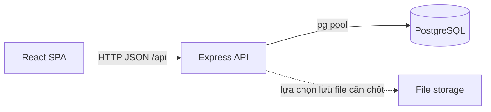

# Quyết định kỹ thuật khởi động · 11/10/2026

## Đã được Long chốt trong trao đổi ngày 11/10

| Hạng mục | Quyết định |
| --- | --- |
| Frontend | React |
| Backend | Node.js + Express + TypeScript |
| Database | PostgreSQL |
| Repository | Hai repo có sẵn: `GiaLongDangPham/lms-backend`, `GiaLongDangPham/lms-frontend` |
| Phạm vi hôm nay | Khung chạy local, tài liệu chuẩn bị, CI; staging tiếp tục ở S1 ngày 12–13/10 |

Frontend dùng TypeScript để thống nhất FE/BE. Cần Nam và Khang xác nhận stack và cách
chạy ở kickoff; Long đã chọn stack cho phần chuẩn bị kỹ thuật.

## Chi tiết triển khai cho khung S1

- Vite xây dựng React SPA. Không cần SSR cho mục tiêu demo hiện tại.
- Node dòng 22, tối thiểu 22.13; `.nvmrc` và CI dùng dòng 22. Dùng bản vá mới trong dòng
  này khi thiết lập máy của từng thành viên. Máy Long hiện có Node 22.17.0.
- npm + lockfile ở mỗi repo; dùng `npm ci` để cài lại đúng dependency.
- Express ESM; TypeScript strict; tách app/server, controller/service/repository theo module.
- Dùng driver `pg`. Ngày 11/10 Long chốt migration SQL có phiên bản dùng pg, UUID
  cho khóa đơn và mã trường để đăng nhập. Có schema/seed D1 local, chưa duyệt CP1;
  Nam cần đồng bộ ID/trường với D2 trước triển khai nghiệp vụ.
- PostgreSQL 17 local qua Docker Compose, volume bền vững; hoặc PostgreSQL có sẵn.
- Local: FE `http://localhost:5173`; BE `http://localhost:3000/api`; DB cổng host 15432
  (container 5432). Cổng 5432 không bind được trong lần thử trên máy Long ngày 11/10.
- CORS dùng allowlist origin. Health kiểm tra process; readiness kiểm tra DB bằng `SELECT 1`.
- ESLint, typecheck, Vitest, build; CI BE có PostgreSQL, migration, db:test và smoke
  test API đã build. CI trên GitHub cần được xác minh sau khi push/PR.

## Hợp đồng hạ tầng hiện có

| Endpoint | Kết quả |
| --- | --- |
| `GET /api/health` | 200, `status: ok`, `service: lms-backend` |
| `GET /api/ready` | 200 + database connected; 503 + database disconnected nếu DB lỗi |

Hợp đồng này phục vụ S1. Nam sở hữu OpenAPI cho 6 module ở D2 (13–14/10), Long duyệt
ở CP1 (15/10). Chốt chung kiểu ID, ngày giờ, enum, error envelope, pagination, upload,
auth và role. Frontend lấy đúng schema/mock từ spec, tránh tự định nghĩa lệch nhau.

## Kiến trúc

Đơn vị triển khai ban đầu là một SPA, một API, một database. Chọn nơi lưu file và
hosting ở kickoff/S1; cần lưu file bền vững sau redeploy. Chưa có cấu hình deploy staging.

## Ràng buộc nghiệp vụ phải giữ

- 3 role Admin/GV/SV; tài khoản được cấp sẵn, không tự đăng ký.
- Admin tạo lớp, phân công GV, ghi danh SV. Một lớp nhiều GV có quyền ngang nhau.
- Giữ lịch sử version, bản mới nhất là hiện hành. Lần nộp đầu có thể Late; khi đã có bài nộp, chỉ được tạo version mới đến deadline hiện tại, trừ khi GV gia hạn. Có Grade kể cả Draft thì khóa nộp vĩnh viễn.
- Một lần nộp có thể nhiều file: thiết kế file attachment và phiên bản bài nộp ở D1.
- File tối đa 25 MiB; tối đa 10 file/resource hoặc version và 100 MiB/version. Chỉ ZIP trong nhóm archive; kiểm tra MIME/nội dung, path traversal, zip bomb và file cấm. Dùng private S3-compatible storage; upload PENDING quá 24 giờ được cleanup, file lịch sử ATTACHED không bị dọn.
- Thời điểm nộp là giờ server khi version và toàn bộ file links commit thành công; sửa deadline không viết lại snapshot/Late của lịch sử.
- Điểm tối đa hai chữ số thập phân. Công bố nguyên bài tập trong một transaction; tự gán 0 cho SV không nộp. Lưu mọi revision điểm, nhưng Draft không bao giờ gửi cho SV.
- Nam cần seed lớp/user/ghi danh để làm B3 trước khi B1 hoàn thành.
- Increment 1: Tài khoản & Lớp, Nội dung, Nộp bài, Chấm & Công bố. Increment 2:
  Thông báo và Comment. Email/trắc nghiệm chỉ bổ sung khi còn nguồn lực.

Nguồn: ba PDF kế hoạch trong thư mục dự án, đặc biệt Task 1.4, 2.2, 2.5, 2.10–2.11
và kế hoạch tuần 01. Các chi tiết triển khai bổ sung ở trên cần được nhóm xác nhận.
